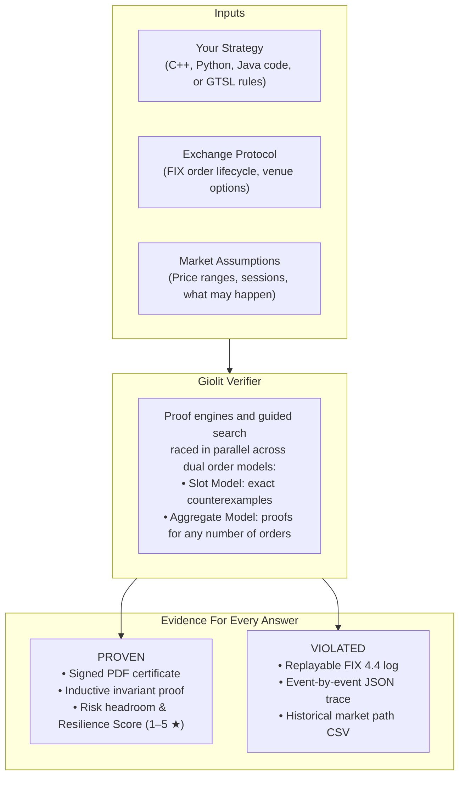

<p align="center">
  
</p>

# Giolit Trade Verifier 1.0 — Trial Edition

[](https://github.com/Giolit-Labs/Giolit-Trade-Verifier/actions/workflows/ci.yml)
[](https://github.com/Giolit-Labs/Giolit-Trade-Verifier/releases)
[](CHANGELOG.md)
[](LICENSE.md)
[](benchmarks/MANIFEST.tsv)

**Stop backtesting bugs. Start proving safety. — Formal proof that every risk control and trading rule holds for ALL market moves, ANY fill timing, and EVERY message interleaving — or the exact event-by-event run that breaks it.**

Backtesting and simulation replay the historical sequences someone thought of or the market happened to produce. **Giolit Trading Risk Verifier explores every sequence the exchange protocol and market assumptions allow.** It reads your trading strategy — directly from its C++, Python, or Java source code, or from a declarative GTSL specification — together with your pre-trade risk controls and exchange protocols, and mathematically decides every rule you state.

> **One of the world's first formal verification engines built specifically for algorithmic trading and market microstructure.** It does all three in a single run: **proves every trading constraint** for unbounded order counts ($N \to \infty$), **hands you the proof itself** (an inductive invariant in your own variable names with a signed PDF certificate), and **grades every limit with a safety margin** — the Giolit Risk Resilience Score, 1 to 5 stars. Measured, not marketed: **0 wrong answers on 180 benchmark rules** across 44 specifications.

| Result | Meaning | Deliverable |
|---|---|---|
| **PROVEN** | No permissible sequence of market moves, fills, cancels, or message reorderings violates the rule — for **any number of orders**. | Signed PDF proof certificate + inductive invariant |
| **VIOLATED** | A real sequence violates the rule — printed event by event, typically 3 to 15 events long. | Replayable FIX 4.4 log + JSON trace + market path CSV |
| **FEASIBLE** / **INFEASIBLE** | An execution goal (e.g. parent order complete by close) is reached on some run / provably impossible. | Witness schedule or mathematical impossibility proof |
| **UNDECIDED** | Not decided within the time budget — reason and tuning advice printed. | Diagnostic report + refinement suggestions |

> **Zero Runtime Overhead:** Giolit is an offline static verifier and CI/CD release gate. It adds **zero nanoseconds** to your live tick-to-trade execution path.  
> **100% On-Premises & Offline:** Zero external solver dependencies, zero cloud calls. All engines run locally. No trading strategies, proprietary alpha models, or parameters ever leave your machines.

---

## Download

This repository hosts the trial bundle — both in the repository tree and as a GitHub Release asset:

- **`giolit-trade-verifier-1.0.0-trial.tar.gz`** (5.0 MB) — the complete distribution: `trade-verify` binary, shared libraries, C++ SDK headers, 27 tutorial designs, 9 strategy templates, 8 SDK examples, documents, benchmarks, and result evidence.
- **`CHECKSUMS.txt`** — SHA-256 of the bundle:

```text
6090ba8169f74f2699745c8e5e7b64d7cee7aea27408debfe675ea7f30296f3a  giolit-trade-verifier-1.0.0-trial.tar.gz
```

Verify after downloading:

```sh
shasum -a 256 -c CHECKSUMS.txt   # macOS
sha256sum -c CHECKSUMS.txt       # Linux
```

---

## Documents (Preview Without Downloading the Bundle)

The [`docs/`](docs/) directory mirrors the documentation inside the bundle for instant in-browser preview:

- [Brochure.pdf](docs/Brochure.pdf) — the product brochure in 6 pages (**start here**)
- [Tutorial-1-Verifying-Trading-Strategies.pdf](docs/Tutorial-1-Verifying-Trading-Strategies.pdf) — verifying strategies step-by-step (C++/Python imports, GTSL, reading proofs, SDK)
- [Tutorial-2-SDK-Guide.pdf](docs/Tutorial-2-SDK-Guide.pdf) — C++ SDK integration guide (token grant, verify, headroom, certificates)
- [Tutorial-3-Algorithmic-Trading-and-Verification.pdf](docs/Tutorial-3-Algorithmic-Trading-and-Verification.pdf) — domain primer on market microstructure, FIX order lifecycles, and formal modeling
- [Reference-Manual.pdf](docs/Reference-Manual.pdf) / [TUTORIAL.md](docs/TUTORIAL.md) — complete language reference and CLI option guide
- [README.md](docs/README.md) / [README.pdf](docs/README.pdf) — quickstart, installation, and commands
- [License-Terms.md](docs/License-Terms.md) / [License-Terms.pdf](docs/License-Terms.pdf) (see also [`LICENSE.md`](LICENSE.md))
- [THIRD-PARTY-NOTICES.md](docs/THIRD-PARTY-NOTICES.md)

---

## The "Aha! Moment": The 3-Second Hedger Bug

Consider an algorithmic pairs hedger: it buys **INFY** in clips of 100 shares and hedges each fill by selling **TCS**.  
**The Hard Risk Policy:** Never hold more than 1 clip unhedged (`always position[INFY] + position[TCS] <= 100`).

```gts
// Common production bug: clip hedger
strategy Hedger {
    parameters { clip = 100; max_long = 1000; }
    rules {
        on market_update when event.symbol == INFY and open_qty(buy, INFY) == 0 and position[INFY] + clip <= max_long {
            buy(clip, limit = market[INFY].bid, symbol = INFY);
        }
        on fill(o) when o.symbol == INFY { sell(o.last_qty, symbol = TCS); }
        on reject(o) when o.symbol == TCS { sell(o.leaves, symbol = TCS); }
    }
}
```

### The Concrete Violation Found by Giolit in 0.44 s

In production, an asynchronous partial fill on INFY interleaves with the pending TCS hedge:

```text
Event 0: Initial state (flat)
Event 1: MarketUpdate INFY  -> NewOrder O1 BUY 100 INFY @ 20000
Event 2: Ack O1
Event 3: Fill O1 100        -> NewOrder O2 SELL 100 TCS @ 20000 (hedge dispatched)
Event 4: MarketUpdate INFY  -> NewOrder O3 BUY 100 INFY (open_qty on INFY is 0, so next clip starts!)
Event 5: Ack O3
Event 6: PartialFill O3 3 shares @ 20001
         ==> Unhedged position = 103 > 100! (TCS hedge is still PendingNew)
```

The second clip started while the first hedge was still in-flight. Testing and backtesting rarely surface this race because historical tick feeds replay synchronous paths. Giolit synthesized the exact 6-event counterexample instantly.

### The 1-Line Fix & Instant Proof for Infinite Orders

Waiting for in-flight hedges before firing the next clip (`open_qty(sell, TCS) == 0`):

```diff
- on market_update when event.symbol == INFY and open_qty(buy, INFY) == 0 and position[INFY] + clip <= max_long {
+ on market_update when event.symbol == INFY and open_qty(buy, INFY) == 0 and open_qty(sell, TCS) == 0 and position[INFY] + clip <= max_long {
```

```sh
$ trade-verify 18_leg_hedger_fixed.gts
  PROVEN      unhedged         always position[INFY] + position[TCS] <= clip
              invariant [aggregate model: any number of orders], 0.44 s
  PROVEN      long_limit       always position[INFY] <= max_long, 0.44 s
  PROVEN      no_tcs_buy       always on new_order: order.symbol == TCS => order.side == sell, 0.44 s

Result: ALL CONSTRAINTS PROVEN (3 proven) in 0.44 s
```

Mathematically proven to hold across **any number of orders**, any market price path, and any execution timing.

---

## 60 Seconds to Your First Proof (Ubuntu 24.04 x86_64)

```sh
# 1. Install system dependencies
sudo apt update
sudo apt install libllvm18 libclang-cpp18 libclang-common-18-dev libc6-dev libssl3
# Optional: LuaLaTeX and qpdf for PDF proof certificates
sudo apt install texlive-luatex texlive-latex-recommended texlive-latex-extra \
                 texlive-pictures texlive-fonts-extra qpdf

# 2. Extract and install (user prefix ~/.local/giolit-trade-verifier)
tar xzf giolit-trade-verifier-1.0.0-trial.tar.gz
cd giolit-trade-verifier-1.0.0-trial/code
./install.sh

# 3. Check trial license (1000 runs within 50 days; uses no trial run)
trade-verify --license

# 4. Verify examples
cp -r ~/.local/giolit-trade-verifier/share/giolit/examples ~/trade-tutorial
cd ~/trade-tutorial

# Prove position limit with open working orders
trade-verify 02_position_limit_fixed.gts               # ALL CONSTRAINTS PROVEN (exit 0)

# Uncover subtle check-then-act bug in naive position limit
trade-verify 01_position_limit.gts                     # CONSTRAINT VIOLATIONS FOUND (exit 1)

# Check risk headroom and Giolit Resilience Score (1 to 5 stars)
trade-verify --headroom 02_position_limit_fixed.gts    # headroom + Resilience Score ★★★★★

# Generate signed PDF proof certificate
trade-verify --report=cert --issued-to="Alpha Trading Desk" 02_position_limit_fixed.gts
```

---

## How It Works: Dual Order Models & In-House Verification

Three inputs, two kinds of answers, evidence for every answer:



### Two Models Verified Side by Side

- **The Slot Model (`--model=slots`):** Tracks up to $K$ live orders (default 4, `--slots=K`) with their exact FIX protocol lifecycle. Every violation it reports is an indisputable, concrete run (zero false positives).
- **The Aggregate Model (`--model=aggregate`):** Tracks total open quantities and bounding invariants. Its proofs hold for **any number of orders ($N 	o \infty$)**, proving safety in under half a second.
- **Parallel Racing (`--model=race`, default):** The verifier races proof engines (seeking unbounded mathematical proofs) and guided search (seeking concrete counterexamples) in parallel.

### Concrete FIX 4.4 Counterexample Trace
When a rule is violated, Giolit automatically exports a standard, RFC-compliant FIX 4.4 execution log (`.fix`) that can be loaded straight into your team's FIX log analyzers or regression test harness:

```fix
8=FIX.4.4|9=112|35=W|34=1|49=EXCHANGE|56=TRADER|55=INFY|269=0|270=1400.00|269=1|270=1400.05|10=045|
8=FIX.4.4|9=124|35=D|34=2|49=TRADER|56=EXCHANGE|11=O1|55=INFY|54=1|38=100|40=2|44=1400.00|60=20261020-09:15:00.100|10=182|
8=FIX.4.4|9=142|35=8|34=4|49=EXCHANGE|56=TRADER|37=X1|11=O1|150=F|39=2|55=INFY|54=1|38=100|14=100|32=100|31=1400.00|10=210|
8=FIX.4.4|9=118|35=D|34=5|49=TRADER|56=EXCHANGE|11=O2|55=TCS|54=2|38=100|40=1|60=20261020-09:15:00.150|10=095|
8=FIX.4.4|9=124|35=D|34=7|49=TRADER|56=EXCHANGE|11=O3|55=INFY|54=1|38=100|40=2|44=1400.05|60=20261020-09:15:00.200|10=190|
8=FIX.4.4|9=146|35=8|34=9|49=EXCHANGE|56=TRADER|37=X3|11=O3|150=F|39=1|55=INFY|54=1|38=100|14=3|32=3|31=1400.05|151=97|10=088|
# VIOLATION: Unhedged exposure = 103 > limit 100
```

---

## Strategy Templates Library

Giolit ships with production-ready strategy templates for every major algorithmic pattern (`trade-verify --template=<name> > my_spec.gts`):

| Template | Standard Constraints Proved as Shipped | Regulatory & Institutional Mapping |
|---|---|---|
| **`market_maker`** | Inventory bounds, quotes never cross spread, quote size caps, passive orders only, kill switch, exact IEEE 754 floating-point. | MiFID II RTS 6 Market Maker Obligations |
| **`twap` / `vwap` / `pov`** | Parent never overfilled, volume curve adherence, participation volume cap, single side, completion before session close. | Best Execution, Implementation Shortfall |
| **`pairs`** | Legging imbalance at most 1 pair, gross exposure limit, individual leg caps, beta-weighted neutrality. | Margin Rules, Legging Risk Control |
| **`lead_lag`** | Trades follower symbol only, inventory limits, single active order enforcement. | Cross-Asset Arbitrage |
| **`delta_hedge`** | Every hedge decreases net delta, zero overshoot, dynamic hedging exposure bounds. | Options Clearing & Portfolio Risk |
| **`smart_order_router`** | Multi-venue overfill prevention, per-venue exposure limits, global kill switch atomicity across venues. | SEC Reg NMS, Smart Order Routing |
| **`pretrade_risk_gateway`** | Order size, notional value caps, price collars/bands, market order blocking, position limits, drop-copy reconciliation. | SEC Rule 15c3-5, SEBI Algo Guidelines |

---

## Real-World Bug Hunt: 4 Bugs Found in Unmodified Open-Source Code

To prove effectiveness on real codebases, Giolit was run directly on unmodified production code from open-source quantitative trading repositories:

| Strategy | Platform | Source Language | Violated Constraint | Real-World Concurrency Bug |
|---|---|---|---|---|
| **Simple PMM** | **Hummingbot** | Python | `one_quote_per_side` (`open_qty <= 1`) | **VIOLATED (2 events):** On timer tick, cancels resting quotes and *immediately* dispatches replacement quotes without awaiting `CancelAck`. During the cancellation flight window, both quotes rest open simultaneously, doubling capital exposure (`open_qty = 2`). |
| **HFT Demo** | **WonderTrader** | C++ | `one_working` & `position_cap` | **VIOLATED (5 & 16 events):** Broker interface splits fills into separate callbacks (`on_trade` and `on_order`). When execution reports interleave with tick updates, calculation triggers while position is updated but order is still tracked, causing the strategy to exceed its position cap. |
| **TWAP Unit** | **WonderTrader** | C++ | `never_past_target` | **VIOLATED (4 events):** Sticky order cancellation races across ticks cause the execution unit to overshoot the parent order's target quantity. |
| **VWAP Unit** | **WonderTrader** | C++ | `never_past_target` | **VIOLATED (4 events):** Dynamic volume curve re-estimation interleaving with pending child executions causes volume overshoot. |
| **DualThrust** | **WonderTrader** | C++ | `within_lots` / `reverse_via_flat` | `within_lots` **PROVEN**; `reverse_via_flat` **VIOLATED:** Strategy abruptly flips from long to short without passing through a flat position. |

---

## Supporting Your Regulatory Obligations

Giolit Trade Verifier directly satisfies the most stringent regulatory and compliance mandates for algorithmic trading:

| Regulatory Mandate | What Giolit Delivers |
|---|---|
| **SEC Rule 15c3-5** (US Market Access Rule) | Proof that pre-trade capital, credit thresholds, price collars, and order size limits hold for **any** strategy connected to your gateway (`--controls-only`), with signed proof certificates. |
| **MiFID II RTS 6** (EU/UK Algo Standards) | Exhaustive pre-deployment stress testing under disorderly market assumptions; proof that kill switch functionality cancels all working orders across all venues without orphan fills. |
| **SEBI Algorithmic Trading Framework** (India) | Dimensional unit checking (tick size, lot size, rupees vs paise); mathematical proof of order-to-trade limits; drop-copy conformance audit (`--conform`). |
| **Annual Self-Assessment & Model Validation** | Self-contained evidence bundles per version: signed PDF certificate, inductive invariants, risk headroom calculations, and reproducible offline validation script (`verify_certificate.py`). |

---

## CLI Options Reference

```sh
trade-verify [options] spec.gts
```

| Option | Description | Default |
|---|---|---|
| `--timeout=SECONDS` | Total verification time budget in seconds | `60` |
| `--controls-only` | Verify pre-trade risk controls for **any** arbitrary strategy | `off` |
| `--constraint=NAME` | Verify only this specific constraint on its cone of influence | `all` |
| `--slots=K` | Live orders tracked in the exact counterexample slot model | `4` |
| `--model=MODE` | Model selection: `race` (slots and aggregate in parallel), `slots`, `aggregate` | `race` |
| `-P NAME=VALUE` | Override strategy or market parameter (`VALUE=any` for arbitrary parameter exploration) | `—` |
| `--report=DIR` | Generate evidence bundle: signed PDF certificate, proofs, FIX logs, market paths | `off` |
| `--issued-to=NAME` | Licensee / counterparty name stamped on the certificate | `—` |
| `--headroom` | Compute worst-case limit values and Giolit Risk Resilience Score (1 to 5 stars) | `off` |
| `--traces=DIR` | Export counterexamples as `.txt`, `.json`, `.fix` (FIX 4.4), and `.csv` | `off` |
| `--conform=LOG` | Replay production drop copy log against specification to detect drift or venue bugs | `off` |
| `--follow[=SEC]` | Live surveillance: watch growing drop copy log in real time (default 2s interval) | `off` |
| `--optimize` | Solves best and worst objective bounds (e.g. implementation shortfall) over all runs | `off` |
| `--baseline=FILE` | Regression detection: fails with exit code 5 if a previously proven rule is lost | `—` |
| `--templates` | View strategy templates (`--template=NAME` prints full specification) | `—` |
| `--import-only` | Dump generated GTSL from C++, Python, or Java `.gbind` without verifying | `off` |
| `--license` | Check remaining trial runs and days (consumes 0 trial runs) | `—` |

**Exit Codes:** `0` All constraints proven · `1` Constraint violated · `2` Undecided / timeout · `3` Input / syntax error · `4` License expired · `5` Regression against baseline.

---

## C++ SDK Guide

Integrate formal verification directly into your proprietary risk engine, trading framework, or automated staging pipeline:

```cpp
#include "giolit/License.hpp"
#include "giolit/Trade.hpp"
#include "giolit/Report.hpp"
#include <iostream>

int main() {
    // 1. Acquire execution token
    giolit::TokenGrant grant = giolit::acquireToken();
    if (!grant.granted) {
        std::cerr << "License error: " << grant.message << "\n";
        return 4;
    }

    // 2. Set options and verify specification
    giolit::TradeOptions opts;
    opts.seconds = 60;
    opts.raceModels = true;

    giolit::TradeResult res = giolit::verifySpec(grant.token, "risk_gateway.gts", opts);

    for (const auto& c : res.constraints) {
        std::cout << c.name << ": " << giolit::toString(c.verdict)
                  << " (" << c.seconds << "s)\n";
    }

    // 3. Compute Risk Headroom and Resilience Score
    giolit::addHeadroom(grant.token, "risk_gateway.gts", opts, res);
    std::cout << "Resilience: " << res.resilienceStars << " / 5 Stars\n";

    // 4. Generate signed PDF proof certificate
    giolit::ReportRequest req;
    req.specFile = "risk_gateway.gts";
    req.outDir = "audit_bundle";
    req.issuedTo = "Alpha Trading Desk";
    giolit::writeReport(grant.token, res, req);

    return res.allProven() ? 0 : 1;
}
```

The trial bundle includes 8 complete, buildable C++ SDK clients in `share/giolit/sdk-examples/` (`verify_spec`, `headroom`, `conform`, `certify`, etc.; build with `./build.sh`).

---

## Enterprise CI/CD Release Gate (`.github/workflows/ci.yml`)

Stop broken trading logic before it merges into main:

```yaml
name: trading-verification
on: [push, pull_request]

jobs:
  verify:
    runs-on: [self-hosted, giolit]   # On-premise runner with trade-verify installed
    steps:
      - uses: actions/checkout@v4

      - name: Download Baseline from Main
        continue-on-error: true
        uses: actions/download-artifact@v4
        with: { name: giolit-baseline, path: baseline }

      - name: Formally Verify All GTSL Specifications
        shell: bash
        run: |
          mkdir -p results
          status=0
          for spec in $(git ls-files '*.gts'); do
            name=$(echo "$spec" | tr '/' '_')
            base=""; [ -f "baseline/$name.json" ] && base="--baseline=baseline/$name.json"
            trade-verify "$spec" --timeout=120 --json="results/$name.json" --junit="results/$name.xml" $base \
              --traces="results/$name.runs" || code=$?
            # Exit 0: Proven, Exit 1: Violated, Exit 5: Regression against baseline
            case "${code:-0}" in 0|2) ;; *) status=1 ;; esac; code=0
          done
          exit $status

      - uses: actions/upload-artifact@v4
        if: always()
        with: { name: giolit-results, path: results }

      - uses: mikepenz/action-junit-report@v4
        if: always()
        with: { report_paths: "results/*.xml" }
```

---

## Verify Your Strategy With Us (Enterprise Pilot)

Unsure how to model your desk's custom order state machines or proprietary risk checks?  
**Send us your anonymized risk policy, FIX Orchestra XML, or strategy state machine outline:**
- We co-author your formal specification in 48 hours.
- We show you your first mathematical proof — or uncover the exact interleaving that breaks your controls.
- **Zero Alpha Disclosure:** Using `mode controls_only;`, you never have to share trading alphas or proprietary signals. The proof certifies your pre-trade risk gateway against *any* strategy it will ever face.

## Licensing

- **Trial Edition:** 1000 runs within 50 days of first run on one computer. Trial documents are watermarked. `trade-verify --license` displays status (consumes no run).
- **Commercial Licenses:** Floating network licenses for CI/CD clusters, unlimited runs, unwatermarked audit certificates branded with your firm license number.
- **Verification Services:** Custom exchange FIX protocol modeling, C++/Python/Java importer bindings, and FPGA/HFT pre-trade gateway verification.

📧 **business.giolitlabs@gmail.com** · 🌐 **http://www.giolit.com**  
Giolit Labs, Ramavarmapuram P.O., Thrissur, Kerala, India
